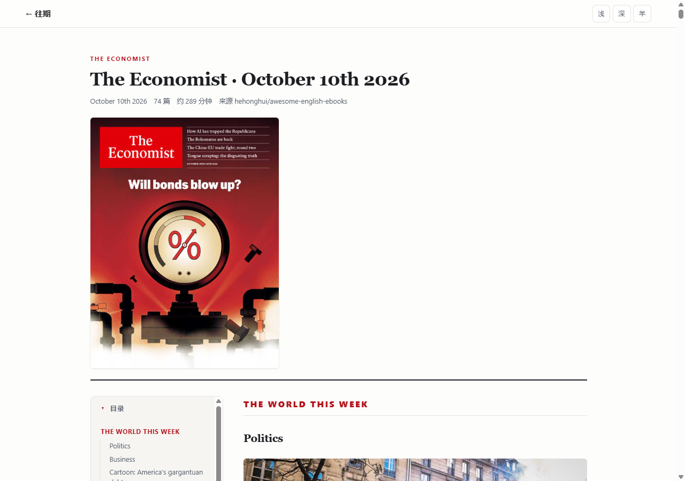

# Economist Digest

《经济学人》每期的整理版，**移动优先排版**，通过 GitHub Pages 发布，
附带 RSS / Atom 订阅源 —— 手机或平板装上阅读器 App 订阅后，新一期自动推送，无需手动查看。

保留**原文文字与全部插图**（《经济学人》的数据新闻图表是内容的一部分），
不含音频、视频与任何第三方交互组件。

> ## ⚠️ 版权与合规边界（请先读）
>
> 《经济学人》的文章、配图与音频版权归 The Economist / Pearson 所有。
> 本项目默认定位为**个人自用**，请注意：
>
> - **不要把仓库和 Pages 站点公开**。公开仓库的 Pages 意味着任何人可访问，
>   构成对原版内容的公开传播。请使用**私有仓库**，
>   并只在自用范围内订阅（GitHub Pages 在私有仓库需 Pro 账号，
>   否则请改用本地 `python -m http.server` 预览）。
> - 收录的是原文文字与原版插图，未做任何付费墙绕过，也未去除版权标识。
> - 若你已订阅《经济学人》，请优先使用官方 App 与音频订阅。
> - 请支持正版：能力允许时优先订阅。

---

## 在手机 / 平板上怎么用

有两条路，**推荐第一条**。

### 方式一：装进阅读器 App（自动推送，最省事）

把订阅地址加进任意支持 RSS 的 App：

```
https://<用户名>.github.io/<仓库名>/feed.xml     # RSS 2.0
https://<用户名>.github.io/<仓库名>/atom.xml     # Atom 1.0
```

- **iPhone / iPad**：App Store 装 **Reeder**、**NetNewsWire**、**Unread**，
  「订阅」→「添加订阅源」→ 粘贴上面的地址。
- **Android**：装 **Feedly**、**Inoreader**、**Fiery Feeds**，
  「添加源」→ 粘贴地址。
- **Kindle**：装 **Flora / Kindle 插件**，用 Send to Kindle 推 EPUB 不适用时，
  可直接用 Reeder 的 Kindle 集成。

设置建议：
- 全文订阅（Full Text / 全文），一期刊有 70+ 篇，摘要模式会很难读。
- 图片已用**绝对地址**写入 RSS，阅读器能正常加载图表。
- 打开「在新窗口打开链接」就能进网页版，可看完整目录与深色模式。

### 方式二：加到主屏幕当 App 用（保留完整交互）

1. 用 **Safari**（iOS）或 **Chrome**（Android）打开站点首页；
2. iOS：分享 → **添加到主屏幕**
   Android：右上角菜单 → **添加到主屏幕 / 安装应用**；
3. 之后从主屏图标进入，全屏无浏览器地址栏，深色模式跟随系统。

这种方式能用到完整的**两级目录**（19 个栏目 + 74 篇文章，可点击跳转），
这是阅读器 App 里没有的。

### 两种方式的差别

| | 阅读器 App 订阅 | 加到主屏幕 |
|---|---|---|
| 新一期提醒 | ✅ 自动弹通知 | ❌ 需自己打开 |
| 离线阅读 | ✅ App 缓存全文 | ⚠️ 需联网 |
| 文章目录跳转 | ❌ 只有列表 | ✅ 两级目录可点 |
| 深色/羊皮纸主题 | ❌ 跟随 App | ✅ 三种主题 |
| 阅读位置记忆 | ✅ App 负责 | ✅ 浏览器负责 |

**建议两个都用**：App 收通知，看到感兴趣的期就点链接进网页版精读。

---

## 效果

| 桌面端：左侧目录常驻，滚动高亮当前文章 | 手机端：目录折叠，正文自适应 |
|---|---|
|  |  |

| 手机端正文插图 + 图注 | 手机端夜间模式 |
|---|---|
|  |  |

---

## 功能

| 能力 | 实现 |
|---|---|
| 每期一个只读页面 | `content/YYYY-MM-DD.md` → `issues/<期号>/index.html` |
| **两级目录** | 19 栏目 + 74 篇文章，桌面常驻侧栏 / 移动折叠，点击跳转 |
| **原文插图** | 每期约 120 张，随期号存于 `content/<期号>/`，构建时复制到 `site/assets/img/` |
| 本期封面 | 期号页与首页列表均显示 |
| 全自动构建发布 | GitHub Actions：定时抓取 → 提交 → 构建 → Pages 部署 |
| 定时检查上游 | `sync.yml` 每 6 小时检查一次，发现新期号自动收录 |
| 打 tag / 发 Release 触发 | `pages.yml` 监听 `v*` tag 与 `release.published` |
| RSS / Atom 订阅 | 均含全文，且图片为绝对地址 |
| 移动优先排版 | 字号 17/18/19px 三档随视口缩放，行高 1.75，正文宽 42rem |
| 深色模式 | 跟随系统 + 手动切换（浅/深/羊皮纸），localStorage 记忆 |
| 长文滚动定位 | 进度条 + 阅读位置记忆（sessionStorage） |
| 手机 / 平板适配 | ≥1000px 双栏，<1000px 单栏目录折叠 |

不含音频、视频与第三方交互组件。

---

## 目录结构

```
economist-digest/
├── content/                      # 内容源
│   ├── 2026-10-10.md             # 每期一个 Markdown
│   └── 2026-10-10/               # 该期图片（123 张，约 5.6 MB）
│       ├── cover.jpg
│       └── *.jpg
├── tools/
│   ├── build.py                  # 生成静态站 + RSS/Atom（零依赖）
│   ├── epub_source.py            # EPUB → Markdown + 图片（共用解析）
│   ├── extract_issue.py          # 本地从 EPUB 生成一期
│   ├── fetch_upstream.py         # 从上游仓库抓取新一期（Actions 定时跑）
│   └── markdown.py               # Markdown 子集解析器
├── templates/
│   ├── base.html                 # 页面骨架
│   ├── index.html                # 首页（期号列表）
│   ├── issue.html                # 期号阅读页
│   ├── feed.xml                  # RSS 模板
│   └── atom.xml                  # Atom 模板
├── assets/
│   ├── style.css                 # 全部样式（含主题变量）
│   └── reader.js                 # 主题切换/目录高亮/进度/定位
├── docs/                         # 效果截图
├── .github/workflows/
│   ├── sync.yml                  # 定时检查上游并提交新内容
│   └── pages.yml                 # 构建并部署 Pages
├── site/                         # 构建产物（.gitignore 已忽略）
└── requirements.txt              # 空：仅用标准库
```

---

## 内容源组织方式

每期一个 Markdown 文件 + 一个同名图片目录。结构分三段：

```markdown
---
issue: "2026.10.10"
date: 2026-10-10
title: "The Economist · October 10th 2026"
source: "hehonghui/awesome-english-ebooks"
articles: 74
minutes: 289
---


## The world this week

### Politics


At least 250,000 demonstrators in France marched through Paris...

### Business

The world's biggest airlines...

## Leaders

### Will bonds blow up?

A government-debt crisis is looming
```

| 字段 | 必填 | 说明 |
|---|---|---|
| `issue` | 是 | 期号，如 `2026.10.10`；决定 URL `/issues/2026.10.10/` |
| `date` | 是 | 出版日期，用于 RSS 的 `pubDate` 与首页排序 |
| `title` | 否 | 缺省显示 `The Economist · <期号>` |
| `source` | 否 | 内容来源，展示在期号页头部 |
| `articles` / `minutes` | 否 | 篇数与预计阅读分钟数，展示用 |

正文层级约定：
- `## 栏目标题` —— 一级，进入目录
- `### 文章标题` —— 二级，进入正文
- `` —— 图片，**路径相对 `content/` 目录**

> 封面写法固定为 ``，构建时会提到期号页头部单独显示。
> 其它图片渲染为 `<figure>` + 图注，出现在原文中。
- 文章标题下的普通段落即正文；`*斜体*` 可作副标题

---

## 新增一期内容

### 方式一：从 EPUB 生成（最省事）

手上有某一期的 EPUB 文件时：

```bash
python tools/extract_issue.py ~/Downloads/TheEconomist.2026.10.17.epub
```

会自动完成：解析 → 剥离广告与推广页脚 → 抽取 120+ 张插图 →
生成 `content/2026-10-17.md` 与 `content/2026-10-17/` 图片目录。

可选参数：

| 参数 | 说明 |
|---|---|
| `--issue 2026.10.17` | 手动指定期号（默认从文件名推断） |
| `--force` | 覆盖已存在的期号 |
| `--no-images` | 不抽图片（纯文字版，产物很小） |
| `--source "xxx"` | 来源标记，会显示在期号页 |

### 方式二：手动写 Markdown

1. 在 `content/` 新建 `YYYY-MM-DD.md`，按上面格式填写；
2. 图片放到 `content/YYYY-MM-DD/` 目录，在正文里用
   `` 引用；
3. 本地预览：
   ```bash
   python tools/build.py --out site --base-url "http://127.0.0.1:8899/"
   cd site && python -m http.server 8899
   ```
4. 提交后 Pages 自动构建：
   ```bash
   git add content/ && git commit -m "content: 2026-10-17" && git push
   ```

### 方式三：自动抓取（配置好后无需再管）

`sync.yml` 每 6 小时自动检查上游仓库是否有新期号，
有则抓取、清洗、抽图、转成 Markdown、提交，随后 `pages.yml` 自动构建发布。
全程无需人工干预。

---

## 部署步骤

### 1. 开启 Pages

仓库页面 → **Settings** → **Pages** → **Source** 选 **GitHub Actions**。

### 2. 配置站点地址（重要）

RSS 里的链接必须是**绝对地址**，否则阅读器无法跳转。

默认按 `https://<用户名>.github.io/<仓库名>/` 自动推导。如需覆盖：

**Settings → Secrets and variables → Actions → Variables → New variable**
- Name: `SITE_URL`
- Value: `https://你的域名/` 或 `https://用户名.github.io/仓库名/`

> 如果仓库名就是 `<用户名>.github.io`，Pages 地址是 `https://<用户名>.github.io/`（无仓库后缀），
> 此时请务必设置 `SITE_URL`。

### 3. 推送代码

```bash
git add .
git commit -m "init: economist digest"
git push origin main
```

首次推送后 `pages.yml` 立即构建并发布。

### 4. 订阅

等首页能打开后，把订阅地址加到阅读器 App：

```
https://<用户名>.github.io/<仓库名>/feed.xml     # RSS
https://<用户名>.github.io/<仓库名>/atom.xml     # Atom
```

推荐 App：Reeder、NetNewsWire、Feedly、Inoreader、
Florence（Kindle 推送）、或任意支持 RSS 的阅读器。

> 定时任务依赖 GitHub Actions 的 cron。**注意**：仓库若连续 60 天无任何活动，
> 定时工作流会被自动停用。正常每周有新内容提交，不会触发此限制。

---

## 本地开发

```bash
# 构建（零依赖，Python 3.8+）
python tools/build.py --out site --base-url "http://127.0.0.1:8899/"

# 预览
cd site && python -m http.server 8899

# 测试抓取（会真实请求上游，注意 API 限额）
GITHUB_TOKEN=ghp_xxx python tools/fetch_upstream.py
```

`build.py` 常用参数：

| 参数 | 说明 |
|---|---|
| `--out DIR` | 输出目录，默认 `site/` |
| `--base-url URL` | 站点根 URL，RSS 需要绝对地址 |

`fetch_upstream.py` 环境变量：

| 变量 | 默认 | 说明 |
|---|---|---|
| `UPSTREAM_REPO` | `hehonghui/awesome-english-ebooks` | 上游仓库 |
| `UPSTREAM_REF` | `master` | 分支 |
| `UPSTREAM_PATH` | `01_economist` | 《经济学人》子目录 |
| `MAX_ISSUES` | `1` | 单次最多抓几期 |
| `GITHUB_TOKEN` | 无 | 提升 API 限额至 5000 次/小时 |

---

## 排版参数

在 `assets/style.css` 顶部的 `:root` 中调整：

| 变量 | 默认 | 说明 |
|---|---|---|
| `--fs-body` | 17 / 18 / 19px | 正文字号，按手机/平板/桌面三档 |
| `--lh-body` | 1.75 | 行高 |
| `--measure` | 34rem | 正文最大宽度（约 60–75 字符/行） |
| `--gap` | 1.15em | 段间距 |

主题：`:root` 为浅色，`html[data-theme="dark"]` 深色，
`html[data-theme="sepia"]` 羊皮纸，`prefers-color-scheme` 跟随系统。

---

## 常见问题

**RSS 阅读器收不到更新？**
阅读器有自己的轮询周期（通常 1–24 小时），不是实时推送。多数 App 支持下拉刷新。

**Pages 部署后样式丢失？**
确认 Settings → Pages 的 Source 是 **GitHub Actions**，不是 branch。
另外 `site/.nojekyll` 已禁用 Jekyll 处理。

**定时工作流没跑？**
GitHub Actions 的 cron 在高峰期可能延迟 10–30 分钟；
仓库长期无活动会被停用定时任务。可在 Actions 页面手动 **Run workflow**。

**想改抓取频率？**
编辑 `.github/workflows/sync.yml` 里的 `cron` 表达式。
`0 */6 * * *` = 每 6 小时；`0 3 * * 1` = 每周一 03:00 UTC。

**上游仓库结构变了？**
检查 `UPSTREAM_PATH` 与 `fetch_upstream.py` 中的 `DIR_RE` 是否还匹配。
